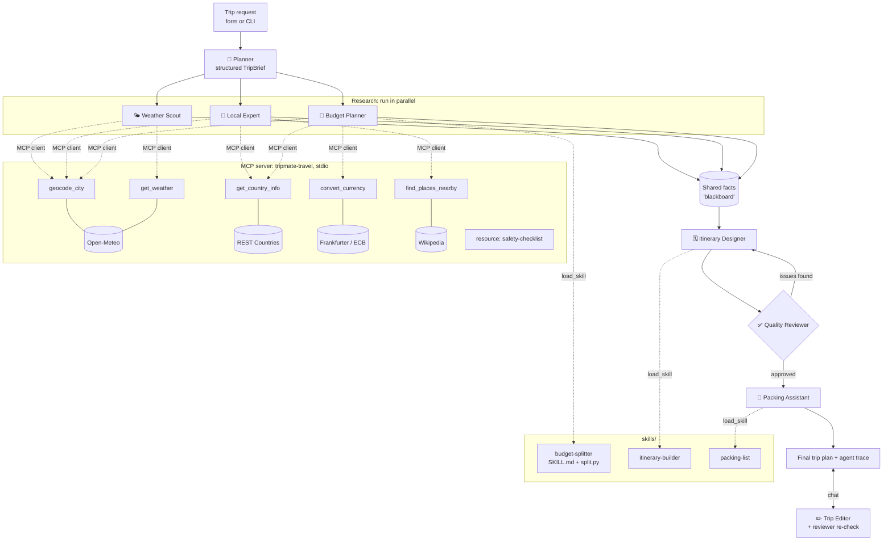

# ✈️ TripMate: a multi-agent group-trip planner

**Tell it where, when, how many friends and your budget. A crew of 8 AI agents
plans it and lets you chat to change it:** a weather-aware day-by-day itinerary using real places,
a fair budget split per person, local tips and a shared packing list.

Built with **Claude** (tool use), a custom **MCP server + client**, four live
**public APIs**, and **Agent Skills** with progressive disclosure.

```
"Birthday trip to Lisbon, 4 of us, Nov 6-9, $900 each.
 We love brunch and photo spots. One of us is vegetarian. No clubbing."
```
→ 7 agents · ~12 tool calls · a self-review loop · about a minute.
Then chat to change it: *"make Day 2 more relaxed"*, *"one of us is vegan now"*.

📘 **New to this? Read [BUILD_GUIDE.md](BUILD_GUIDE.md)**: a beginner's step-by-step guide to how it's built.
🎤 **Presenting it? Read [INTERVIEW_GUIDE.md](INTERVIEW_GUIDE.md).**

---

## Architecture



## Where the data comes from

| Agent | Data source | Real or mocked? |
|---|---|---|
| 🧭 Planner | The form the user fills in | User input, not external data |
| 🌤️ Weather Scout | Open-Meteo geocoding + forecast (historical API for trips >2 weeks out) | **Real**: live forecast for the actual dates and city; further out, real weather from the same dates last year as an estimate |
| 📍 Local Expert | REST Countries + Wikipedia GeoSearch; emergency numbers from a small built-in list | **Real** facts and landmark names (not restaurants or ratings); emergency numbers are our own static list |
| 💸 Budget Planner | Own logic (`split.py`) + Frankfurter (ECB) exchange rates | **Real arithmetic and real FX rate**; split percentages are our estimates, not real prices |
| 🗓️ Itinerary Designer | Combines the data above (may call the places tool) | **Generated** from real data; told never to invent restaurant names |
| ✅ Quality Reviewer | Compares the plan with the fetched data | Generated judgment, checked against real data |
| 🧳 Packing Assistant | Weather + itinerary + country | **Generated**, not fetched |
| ✏️ Trip Editor | The user's chat message + current plan | User input |
| 🛟 Safety section | MCP resource | Static text we wrote |

If an API fails (or "offline sample data" is on), each tool returns bundled sample data marked `source: offline-sample`. Without an API key, demo mode templates the writing while every agent, tool and skill still runs.

### What each piece demonstrates

| Rubric item | Where | What to point at |
|---|---|---|
| **Orchestration of multiple agents** | `tripmate/orchestrator.py` | 7 specialist agents; 3 run in parallel (`asyncio.gather`); evaluator-optimizer loop (reviewer → designer revises); structured hand-offs |
| **MCP server** | `mcp_server/travel_server.py` | 5 tools + 1 resource + 1 prompt (all three MCP primitives), stdio transport, works in Claude Desktop too |
| **MCP client** | `tripmate/mcp_client.py` | Launches the server, discovers tools at runtime, converts MCP schemas to Claude tool schemas |
| **Accessing data via APIs** | MCP server | Open-Meteo (geocoding, forecast, historical climate), REST Countries, Frankfurter (ECB FX), Wikipedia geosearch; no keys needed |
| **Building skills** | `skills/*/SKILL.md` | Progressive disclosure: agents see one-line summaries and call `load_skill` on demand. `budget-splitter` ships code (`split.py`) that becomes a tool |
| **Human-in-the-loop revision** | `tripmate/revision.py` | Chat edits: Trip Editor changes only what was asked, Reviewer re-checks, big changes ask to re-plan |
| **Agent loop** | `tripmate/agents.py` | ~100-line framework-free tool-use loop: parallel tool execution, tool errors returned to the model, structured output via a forced tool |

### Design decisions

- **Least privilege per agent.** The Weather Scout can't call the currency tool. Smaller toolsets mean fewer wrong calls and lower cost.
- **Structured output through tools.** The Planner and Reviewer must answer by calling `submit_trip_brief` / `submit_review` with a JSON schema, so the orchestrator branches on real fields (`approved: false`), not on parsing prose.
- **Deterministic guardrails over LLM output.** Dates, head-count and budget from the form overwrite whatever the Planner inferred; `nights` is computed in code.
- **Math in code, not in the model.** Budget arithmetic runs in `split.py`; the skill tells the agent never to calculate itself.
- **Grounding through a shared blackboard.** Raw tool outputs (not just agent prose) go to later agents, and the reviewer checks every place name against the real list, which cuts down hallucinated venues.
- **Graceful degradation.** Each MCP tool falls back to bundled sample data (tagged `source: offline-sample`) if an API is down. A demo brain lets the whole system run with no API key.

---

## Run it

Requires Python 3.10+.

```bash
cd tripmate
python -m venv .venv && source .venv/bin/activate     # Windows: .venv\Scripts\activate
pip install -r requirements.txt
cp .env.example .env                                  # then paste your Anthropic key into .env
```

**Web app (best for the demo)**
```bash
streamlit run app.py
```

**Command line**
```bash
python cli.py                       # sample Lisbon birthday trip with Claude + live APIs
python cli.py --demo --offline      # no API key, no internet: still runs every agent, MCP and skill
python cli.py --chat                # plan, then chat to change it
python cli.py -d Nashville -s 2026-11-06 -e 2026-11-09 -p 6 -b 750 \
   -v "Bachelorette weekend" -n "Must hear live music. One friend is gluten-free. No early mornings."
```

**Tests** (no key or internet needed): `pytest -q`

**Inspect the MCP server on its own**
```bash
npx @modelcontextprotocol/inspector python mcp_server/travel_server.py
```

**Use the same MCP server inside Claude Desktop:** add `claude_desktop_config.example.json`
to your Claude Desktop config (fix the path), restart, and ask Claude *"What's the weather in Lisbon next weekend?"*.

### Configuration
| Variable | Default | Purpose |
|---|---|---|
| `ANTHROPIC_API_KEY` | (none) | If missing, the app automatically uses demo mode |
| `TRIPMATE_MODEL` | `claude-sonnet-5-5` | Any Claude model ID |
| `TRIPMATE_OFFLINE` | `0` | `1` = MCP server uses bundled sample data |

---

## Project layout
```
tripmate/
├── app.py                     Streamlit UI with live agent trace
├── cli.py                     Command-line runner
├── mcp_server/
│   ├── travel_server.py       MCP server: 5 tools, 1 resource, 1 prompt
│   └── fixtures.py            Offline fallback data
├── skills/
│   ├── budget-splitter/       SKILL.md + split.py (code tool)
│   ├── itinerary-builder/     SKILL.md
│   └── packing-list/          SKILL.md
├── tripmate/
│   ├── contracts.py           Data shapes + structured-output schemas
│   ├── orchestrator.py        The agent team + pipeline
│   ├── revision.py            Chat revisions (Trip Editor + re-review)
│   ├── agents.py              Agent tool-use loop
│   ├── mcp_client.py          MCP client → Claude tool schemas
│   ├── skills.py              Skill registry (progressive disclosure)
│   ├── llm.py                 Claude wrapper + model selection
│   └── demo_llm.py            Offline scripted brain (same protocol)
└── tests/test_tripmate.py
```

## What I'd do next for production
- **Evals:** a set of 30 trip requests scored on grounding (places real?), budget fit and preference coverage; track it per prompt change.
- **Prompt caching** on system prompts and skills to cut cost and latency.
- **Streaming** the itinerary token by token into the UI.
- **Group voting:** let each friend vote on the draft itinerary before it's final.
- **More MCP servers:** flights and hotels (e.g. Amadeus), maps for walking times, a calendar to invite friends.
- **Observability:** OpenTelemetry spans per agent and tool call; per-trip cost reporting.
- **Remote MCP** over Streamable HTTP with auth, so the travel tools serve many apps.
